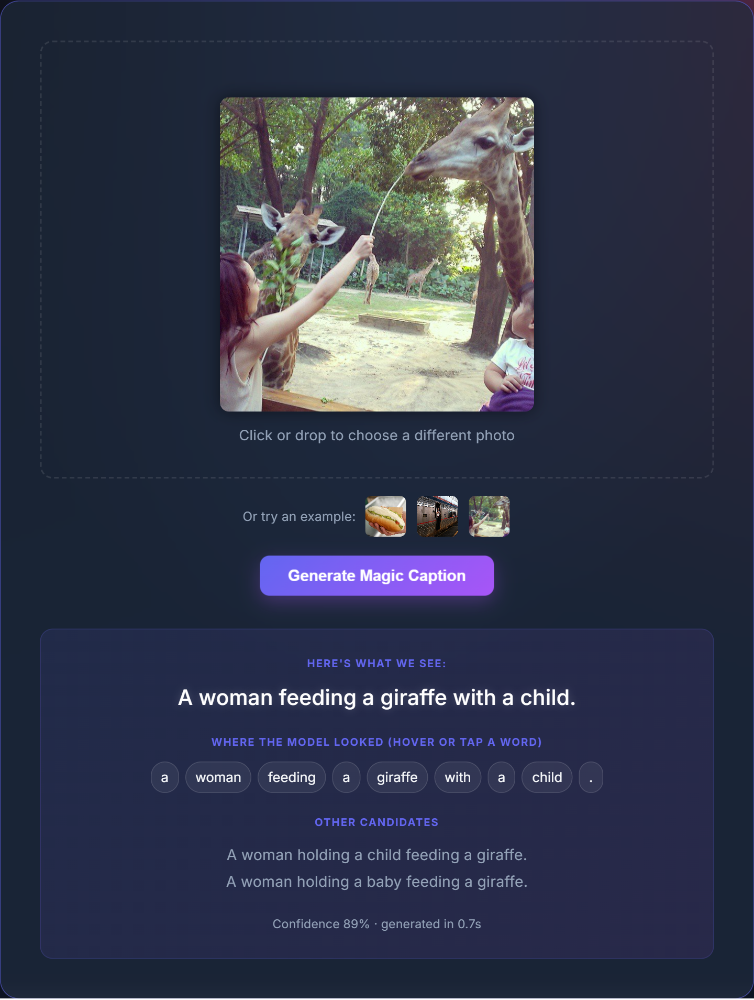
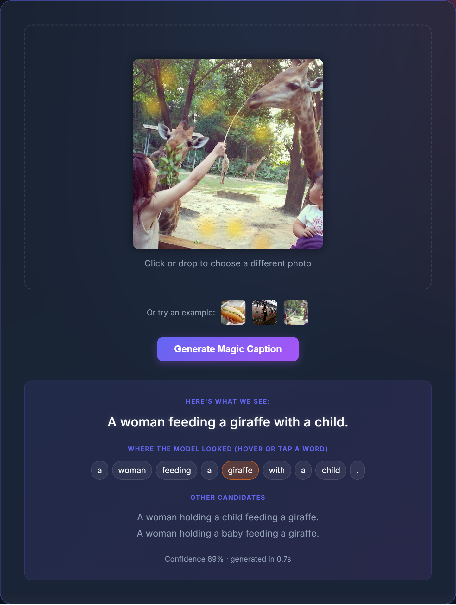

# CHAPTER 4: RESULTS AND ANALYSIS

## 4.1 Introduction
This chapter presents the experimental evaluation of the image captioning system developed in this project. The final system pairs a frozen CLIP ViT-B/16 vision encoder with a trainable Transformer encoder-decoder, and is trained in two stages: cross-entropy training with teacher forcing, followed by Self-Critical Sequence Training (SCST), a reinforcement learning method that optimises the CIDEr metric directly.

The chapter first describes the dataset, model configuration and experimental setup. It then analyses the training dynamics of both stages, including a numerical instability observed during the first stage and how it was handled. The quantitative results on the MS COCO test split are reported with the standard captioning metrics, followed by an ablation study on decoding settings, a qualitative error analysis and a discussion of limitations.

---

## 4.2 Dataset and Preprocessing

### 4.2.1 MS COCO with the Karpathy Split
All experiments use the MS COCO 2014 images with the widely used Karpathy split, which makes the results comparable to published work.

| Split | Images | Captions per image |
| :--- | :--- | :--- |
| Train (train + restval) | 113,287 | ~5 |
| Validation | 5,000 | ~5 |
| Test | 5,000 | ~5 |

During training, only the first 1,000 validation images were used for per-epoch model selection to keep validation fast. All final results are reported on the full 5,000-image test split, which was never used for training or model selection.

### 4.2.2 Text Preprocessing
Captions were lowercased and tokenised into words and punctuation. A vocabulary was built from the training captions using a minimum frequency threshold of 5; rarer words are mapped to the `<UNK>` token. The final vocabulary contains **10,084 tokens**, including the special tokens `<PAD>`, `<SOS>`, `<EOS>` and `<UNK>`.

### 4.2.3 Image Preprocessing and Feature Caching
Each image was resized (bicubic) and centre-cropped to 224 × 224 pixels and normalised with the CLIP mean and standard deviation. Because the CLIP backbone is frozen, its output was computed once for every image and cached to disk. Training therefore operates on these cached features, which reduces each training step to the cost of the trainable head and decoder. A consequence is that no random image augmentation is applied during training.

---

## 4.3 Model Architecture

### 4.3.1 Overview
The model follows the encoder-decoder paradigm:

1. **Frozen visual backbone:** CLIP ViT-B/16 (`openai/clip-vit-base-patch16`). The final hidden layer provides 197 tokens per image (one CLS token plus a 14 × 14 grid of patch tokens), each of dimension 768.
2. **Trainable encoder head:** a linear projection from 768 to 512 dimensions, a learned positional embedding over the 197 tokens, two Transformer encoder layers (8 heads, feed-forward size 2048) that let the visual tokens exchange context, and a final layer normalisation.
3. **Transformer decoder:** 6 layers, 8 attention heads, embedding size 512, feed-forward size 2048, sinusoidal positional encoding and a causal mask. Each layer applies masked self-attention over the words generated so far and cross-attention over the 197 visual tokens.

The trainable part of the model has **42.4 million parameters** (6.8M in the encoder head and 35.6M in the decoder); the CLIP backbone's weights are not updated.

### 4.3.2 Choice of Backbone
CLIP was pre-trained contrastively on a very large collection of image-text pairs, so its visual features are already aligned with natural-language concepts. This makes it a stronger starting point for captioning than an ImageNet-trained classifier such as ResNet-50, whose features are optimised for 1,000 object classes. The patch grid also preserves spatial layout, which the decoder's cross-attention can exploit, and which makes the attention maps interpretable as heatmaps over the image.

---

## 4.4 Experimental Setup

### 4.4.1 Hardware and Software
*   **GPU:** NVIDIA GeForce RTX 5050 Laptop GPU (8 GB VRAM)
*   **CPU:** AMD Ryzen 7 260 (3.80 GHz)
*   **Memory:** 16 GB RAM
*   **Operating system:** Windows 11 (64-bit)
*   **Framework:** PyTorch with Hugging Face Transformers (for the CLIP backbone)
*   **Evaluation:** `pycocoevalcap` (the official COCO caption evaluation code)

### 4.4.2 Training Configuration

| Parameter | Stage 1: Cross-Entropy (XE) | Stage 2: SCST |
| :--- | :--- | :--- |
| Objective | Cross-entropy, teacher forcing | Policy gradient on CIDEr-D reward |
| Optimizer | AdamW (weight decay 0.01) | AdamW (no weight decay) |
| Learning rate | 3 × 10⁻⁴ peak | 1 × 10⁻⁵ constant |
| LR schedule | 2,000-step linear warmup, then cosine decay | None |
| Batch size | 64 captions | 32 images × 5 sampled captions |
| Label smoothing | 0.1 | n/a |
| Gradient clipping | Max norm 1.0 | Max norm 1.0 |
| Precision | Mixed (float16 autocast) | Full (float32) |
| Max epochs | 30 | 3 |
| Early stopping | Patience 4 epochs on val CIDEr-D | n/a |
| Dropout | 0.1 | Disabled during sampling |

**Model selection.** After every epoch, the model greedily decoded the 1,000 validation images and was scored with CIDEr-D. The checkpoint with the highest validation CIDEr-D was kept as the best model of each stage.

**SCST details.** For each training image, five captions are sampled from the model. Each sample's reward is its CIDEr-D score against the reference captions (with document frequencies computed on the training corpus), and its baseline is the mean reward of the other four samples. Samples that score above their siblings are reinforced and those below are suppressed. This baseline requires no extra greedy decoding pass.

### 4.4.3 Evaluation Protocol
Test captions were generated by beam search with length normalisation (α = 0.7), a maximum length of 20 tokens and a repetition penalty: a content word that already appears in a beam is penalised by 2.0 in log-probability, while function words such as "a", "the" and "of" may repeat freely. Unless stated otherwise, results use a beam size of 3. Punctuation was removed before scoring. BLEU-1 to BLEU-4, ROUGE-L and CIDEr were computed with `pycocoevalcap`. METEOR and SPICE require a Java runtime, which was not available on the evaluation machine, so they are not reported.

Note that the per-epoch validation scores in Section 4.5 (greedy decoding, CIDEr-D, 1,000 images) and the test scores in Section 4.6 (beam search, CIDEr, 5,000 images) are measured under different settings and are not directly comparable to each other.

---

## 4.5 Training Dynamics

### 4.5.1 Stage 1: Cross-Entropy Training
One epoch of cross-entropy training took approximately 25 minutes. The table below lists the per-epoch training loss and validation CIDEr-D, together with the caption generated for the first validation image (a boy standing beside cattle).

| Epoch | Train loss | Val CIDEr-D | Example caption |
| :--- | :--- | :--- | :--- |
| 1 | 3.757 | 1.037 | a boy is holding a cow in the dirt . |
| 2 | 3.206 | 1.142 | a boy holding an umbrella standing next to a cow . |
| 3 | 3.103 | 1.164 | a boy holding a small umbrella in front of a herd of cattle . |
| 4 | 3.038 | 1.184 | a boy holding a small gun in front of a herd of cows . |
| 5 | 2.989 | 1.163 | a boy holding an umbrella and a cow . |
| 6 | 2.949 | 1.186 | a boy is walking with a cow in a field . |
| 7 | 2.914 | 1.201 | a young boy is standing next to a cow . |
| 8 | 2.884 | 1.221 | a boy is standing next to a cow and a cow . |
| **9** | **2.855** | **1.222** | **a boy is holding a small animal in a field .** |
| 10 | 3.212 | 0.084 | a woman is holding a umbrella and a woman umbrella . |
| 11 | NaN | 0.000 | a a a a a a a a a a a a a a a a a a a a |
| 12 | 30.656 | 0.000 | a a a a a a a a a a a a a a a a a a a a |
| 13 | 29.640 | 0.000 | a a a a a a a a a a a a a a a a a a a a |

**Convergence (epochs 1–9).** Validation CIDEr-D rose quickly in the first epochs: by epoch 1 the model already produced fluent captions. Gains then slowed, with epoch 9 improving on epoch 8 by only 0.001, indicating that the cross-entropy objective was close to its plateau. The training loss does not approach zero because label smoothing (0.1) deliberately spreads probability mass over the vocabulary; the floor of roughly 2.8–2.9 is expected under this setting. The temporary drop at epoch 5 is normal epoch-to-epoch variation.

**Training instability (epochs 10–13).** During epoch 10, training diverged: the average loss rose from 2.86 to 3.21, then became NaN in epoch 11, and the model collapsed into a degenerate state that repeats the most frequent token ("a") until the length limit. Validation CIDEr-D fell to essentially zero, and early stopping ended the run after four epochs without improvement.

The most likely cause is the combination of float16 mixed-precision arithmetic, whose limited numeric range can overflow, with a still relatively high learning rate in the middle of the cosine schedule. Gradient clipping and the dynamic loss scaler did not prevent the collapse. The available logs do not show whether the divergence began with a float16 overflow or with an unstable optimizer update. Two safeguards would address this in future runs: training in bfloat16, which has the same numeric range as float32, and skipping any batch whose loss is not finite.

**Effect on the results.** Because the best checkpoint is saved whenever validation CIDEr-D improves, the epoch-9 model (val CIDEr-D 1.222) was preserved before the divergence. All subsequent results start from this checkpoint, so the instability did not affect the final model. Given how little epochs 8–9 were still improving, re-running the remaining epochs was judged unlikely to change the outcome materially.

### 4.5.2 Stage 2: Self-Critical Sequence Training
SCST started from the epoch-9 cross-entropy checkpoint and ran for 3 epochs, each taking approximately 1.5 hours. Training ran in full precision with a learning rate 30 times lower than stage 1, and no instability was observed.

| Epoch | Mean sampled CIDEr-D (train) | Val CIDEr-D | Example caption |
| :--- | :--- | :--- | :--- |
| 0 (start, XE epoch 9) | n/a | 1.222 | a boy is holding a small animal in a field . |
| 1 | 1.075 | 1.344 | a boy standing next to a cow in a field . |
| 2 | 1.303 | 1.379 | a young boy standing next to two cows . |
| **3** | **1.369** | **1.393** | **a young boy standing next to two cows .** |

Validation CIDEr-D improved by 0.171 over the three epochs, with the largest gain in the first epoch (+0.121) and diminishing gains afterwards (+0.035, +0.014). The training reward is the average CIDEr-D of randomly *sampled* captions, which are noisier than the greedy captions used for validation; its steady rise (1.08 → 1.37) shows the sampling distribution concentrating on high-reward captions.

The example captions also illustrate the effect of SCST qualitatively. The cross-entropy model's captions for this image varied between epochs and included incorrect objects (an umbrella, a gun) and a repetition ("a cow and a cow"). After SCST, the caption is shorter, drops the hallucinated objects and states the count of animals.

---

## 4.6 Quantitative Results

### 4.6.1 Main Results
The table below reports the best checkpoint of each stage on the 5,000-image Karpathy test split (beam size 3, repetition penalty 2.0).

| Model | BLEU-1 | BLEU-2 | BLEU-3 | BLEU-4 | ROUGE-L | CIDEr |
| :--- | :--- | :--- | :--- | :--- | :--- | :--- |
| CLIP ViT-B/16 + Transformer, XE (stage 1) | 0.779 | 0.618 | 0.480 | 0.370 | 0.580 | 1.228 |
| **CLIP ViT-B/16 + Transformer, XE + SCST (stage 2)** | **0.816** | **0.669** | **0.527** | **0.407** | **0.600** | **1.354** |
| *Absolute gain from SCST* | +0.038 | +0.052 | +0.047 | +0.037 | +0.020 | +0.126 |

SCST improves every metric. The largest relative gain is in CIDEr (+10.3%), the metric that SCST optimises, but BLEU and ROUGE-L also improve, which shows that the model did not simply learn to exploit CIDEr at the expense of the other measures.

The improvement in BLEU-1 is partly a precision effect. The SCST model's captions are slightly shorter than the references (45,421 generated tokens against an effective reference length of 46,059, a ratio of 0.986), whereas the cross-entropy model's captions were slightly longer (ratio 1.005). The SCST model therefore uses fewer words but more of them match the references: 82.8% of its unigrams match a reference, against 77.8% for the cross-entropy model.

### 4.6.2 Comparison with an Earlier Baseline
An earlier version of this project used an ImageNet-trained ResNet-50 backbone (7 × 7 grid of 2,048-dimensional features) with the same decoder design, trained with cross-entropy only. It was evaluated on only the first 250 test images:

| Model | Test images | BLEU-1 | BLEU-4 | ROUGE-L | CIDEr |
| :--- | :--- | :--- | :--- | :--- | :--- |
| ResNet-50 + Transformer, XE (earlier baseline) | 250 | 0.615 | 0.212 | 0.464 | 0.688 |
| CLIP ViT-B/16 + Transformer, XE + SCST (final) | 5,000 | 0.816 | 0.407 | 0.600 | 1.354 |

Because the baseline was trained in an earlier version of the pipeline and evaluated on a much smaller subset, this comparison is indicative rather than controlled. It nevertheless shows a large gap, consistent with the expectation that CLIP's language-aligned, higher-resolution features (197 tokens against 49) provide a far better starting point for captioning.

---

## 4.7 Ablation Study: Decoding Settings
To measure the contribution of the decoding procedure, the final SCST model was evaluated on the full test split with beam sizes 1, 3 and 5, each with and without the repetition penalty.

| Beam size | Repetition penalty | BLEU-1 | BLEU-4 | ROUGE-L | CIDEr |
| :--- | :--- | :--- | :--- | :--- | :--- |
| 1 | off | 0.814 | 0.402 | 0.599 | 1.342 |
| 1 | 2.0 | 0.814 | 0.402 | 0.599 | 1.342 |
| 3 | off | 0.816 | 0.407 | 0.601 | 1.350 |
| 3 | 2.0 | 0.816 | 0.407 | 0.600 | 1.354 |
| 5 | off | 0.816 | 0.407 | 0.601 | 1.352 |
| **5** | **2.0** | **0.817** | **0.407** | **0.600** | **1.355** |

**Beam size.** Moving from a beam size of 1 to 3 improves CIDEr by 0.012 and BLEU-4 by 0.004; increasing it further to 5 adds only 0.001 CIDEr. This small effect is characteristic of SCST-trained models: SCST sharpens the output distribution so that the single most probable caption is already close to the best one the model can produce, leaving little for a wider search to find. A beam size of 3 therefore captures nearly all of the benefit at lower cost and is used as the default.

**Repetition penalty.** With a beam size of 3 or 5, the penalty adds 0.003–0.004 CIDEr. With a beam size of 1, it has no effect, because only one candidate is kept per step and a penalty cannot change which candidate ranks first. Without the penalty, 3.6% of the SCST model's test captions repeat a content word (Section 4.8.3). The penalty removes most of these errors, but they occur in too few captions to move the corpus-level scores much, which explains the small numeric gain.

---

## 4.8 Qualitative Analysis and Error Analysis

### 4.8.1 Web Application
The final XE + SCST model is deployed as a web application. The React frontend is hosted on Vercel, and the backend API runs the model on a CPU in a Hugging Face Space. The user uploads a photo or picks one of three example images, and the backend returns the best caption from beam search, two alternative candidates, a confidence score and the decoder's attention weights for every generated word. On the hosted CPU, a caption is generated in about one second.

Hovering over a word in the caption overlays the decoder's cross-attention for that word on the image (Figure 4.3). For this example, the attention for "giraffe" is spread over several small regions, including foliage and ground, rather than concentrated on the giraffes. This is typical when attention is read from a model that uses CLIP patch tokens: after twelve layers of self-attention inside CLIP, each patch token already carries information about the whole image, so the decoder does not need to attend to an object's own patches to recognise it. Cross-attention maps of this model should therefore be read as a rough indication of where information was drawn from, not as an object localisation.

### 4.8.2 Example Captions
The table below compares the captions of both models on test images. The first five were drawn at random; the last two are among the highest-scoring captions of the SCST model. For each image, one of the five human reference captions is shown.

| Test image (COCO id) | XE model | XE + SCST model | Reference (one of five) |
| :--- | :--- | :--- | :--- |
| 327177 | a cat is sitting on top of a car . | a cat sitting on the hood of a car . | A cat sitting on top of a green car. |
| 227523 | a red stop sign with a green street sign above it . | a stop sign with two street signs on top of it . | A red stop sign sitting under two green street signs. |
| 503311 | a man is walking on the beach with a surfboard . | a man walking on the beach with a surfboard . | The kite surfer is walking on the beach holding the kite. |
| 147556 | a man is standing next to two elephants . | a group of people standing on the back of two elephants . | An elephant standing in the middle of a tent. |
| 337042 | a city at night with a lot of neon signs . | a car driving down a street at night . | An asian city is all lit up in the dark. |
| 109939 | a red double decker bus driving down a street . | a red double decker bus driving down a street . | A red double decker bus driving down a street. |
| 27570 | a woman in a white dress blow drying her hair . | a woman blow drying her hair in a bathroom . | A woman blow drying her hair, in he mirror. |

The random examples show that both models usually identify the main objects and their relation correctly. The SCST captions are more specific in places ("on the hood of a car", "two street signs") and drop the auxiliary verb "is", matching the telegraphic style of the COCO references. The last two random examples show typical failures: in image 147556 the SCST model describes a plausible but incorrect scene (people riding elephants), and in image 337042 it replaces the scene-level description ("a city at night") with a single object that may not be the focus of the image.

### 4.8.3 Corpus-Level Caption Statistics
To quantify these effects, all 5,000 test captions of both models were analysed and scored individually with CIDEr-D.

| Statistic | XE model | XE + SCST model |
| :--- | :--- | :--- |
| Mean caption length (words) | 9.53 | 9.09 |
| Distinct words used | 1,149 | 718 |
| Distinct captions (out of 5,000) | 3,967 | 3,550 |
| Captions mentioning a quantity ("two", "group", "several", …) | 672 | 1,120 |
| Captions starting with "a group of" | 397 | 664 |
| Captions with per-image CIDEr-D above 2.0 | 753 | 958 |
| Captions with per-image CIDEr-D below 0.1 | 89 | 60 |

The average human reference caption is 10.44 words long. The XE captions were decoded with beam size 3 and the repetition penalty; the SCST captions in this analysis come from the beam size 5 run without the penalty (CIDEr 1.352, Section 4.7), which was the last configuration evaluated.

SCST shifts the distribution of per-image scores upwards: 27% more captions score above 2.0 and 33% fewer score below 0.1. At the same time, the model uses 37% fewer distinct words and produces more duplicate captions. This trade-off is expected: CIDEr rewards n-grams that many human annotators agree on, so SCST steers the model towards safe, frequently used words and phrases at the expense of rarer, more specific ones.

### 4.8.4 Observed Error Types
1.  **Object and scene hallucination.** The model sometimes describes a scene that is plausible for the detected objects but wrong for the image. Examples from the lowest-scoring test captions include "a little girl holding a pink umbrella on a beach" for two children standing in grass, "a giraffe standing next to a tree" for two bears in tall grass, and "a group of teddy bears sitting on a table" for a display case of dolls. During training, the XE model also hallucinated objects for the tracked validation image ("an umbrella", "a small gun"); SCST removed these for that image.
2.  **Unusual images.** Many of the lowest-scoring captions belong to images that are atypical for COCO: dioramas, museum exhibits, artwork, black-and-white photographs and screenshots of television broadcasts. The model describes these with the closest everyday scene ("a room with pots and pans on a table" for a kitchen diorama), because such content is rare in the training captions.
3.  **Repetition.** Without the repetition penalty, 180 of the SCST model's 5,000 captions (3.6%) repeat a content word, for example "a display of donuts in a display case" or "a boat with a boat in the water". Some repetitions are legitimate ("a tennis ball sitting on top of a tennis racket"), which is why the penalty is applied softly rather than as a ban.
4.  **Counting.** The SCST model mentions quantities more often than the XE model (1,120 against 672 captions), but the counts are not always right. Of the 410 SCST captions that say "two", 262 (64%) agree with at least two of the five reference captions. Larger numbers are rare: "three" appears in only 41 captions.
5.  **Generic phrasing.** "a group of" opens 13% of all SCST captions (against 8% for the XE model), and phrases such as "a man riding" and "a bathroom with" recur hundreds of times. These captions are rarely wrong, but they lose detail that distinguishes one image from another.

---

## 4.9 Limitations
1.  **Missing METEOR and SPICE.** These two metrics could not be computed because Java was not installed on the evaluation machine. SPICE in particular measures semantic correctness (objects, attributes and relations) better than n-gram metrics.
2.  **Frozen backbone.** The CLIP encoder was not fine-tuned. This made training feasible on a laptop GPU through feature caching, but it limits how far the visual features can adapt to the captioning task, and rules out image augmentation.
3.  **Training instability.** Mixed-precision training diverged at epoch 10 of stage 1. The best checkpoint was unaffected, but the run did not complete its full schedule, so it remains possible that a stable run would have improved slightly further.
4.  **Short SCST stage.** SCST ran for 3 epochs because of compute constraints. Validation CIDEr-D was still rising at the last epoch, so a longer stage would likely give a small further improvement.
5.  **Single run.** Each configuration was trained once. Differences of a few thousandths, such as those between beam sizes 3 and 5, are within the range that could change with a different random seed.
6.  **Reduced caption diversity.** SCST improved the scores but reduced the model's vocabulary from 1,149 to 718 distinct words (Section 4.8.3), making captions more generic.
7.  **Baseline comparability.** The ResNet-50 baseline was evaluated on 250 test images in an earlier version of the pipeline, so it is not a controlled comparison.

---

## 4.10 Future Work
1.  **Stable mixed-precision training** with bfloat16 and non-finite loss detection, so that the first stage can complete its full schedule.
2.  **Longer SCST training**, since validation CIDEr-D had not yet plateaued.
3.  **Partial fine-tuning of the CLIP backbone** (for example, its last few layers) with a low learning rate.
4.  **A controlled backbone comparison**, retraining the ResNet-50 baseline with the current pipeline and evaluating it on the full test split.
5.  **Full metric coverage**, adding METEOR and SPICE by installing a Java runtime.

---

## 4.11 Conclusion
The final model, a frozen CLIP ViT-B/16 encoder with a Transformer decoder trained by cross-entropy and then SCST, achieves **CIDEr 1.354, BLEU-4 0.407 and ROUGE-L 0.600** on the 5,000-image MS COCO Karpathy test split. SCST improved every metric over the cross-entropy model, with CIDEr rising by 0.126, and reduced the number of very poor captions (per-image CIDEr-D below 0.1) by a third, at the cost of a smaller and more generic vocabulary. Beam search and the repetition penalty contribute only small additional gains once the model is trained with SCST. The results show that a captioning model of this quality can be trained on a single laptop GPU by caching the features of a strong pre-trained vision encoder, provided that training is guarded against numerical instability.
